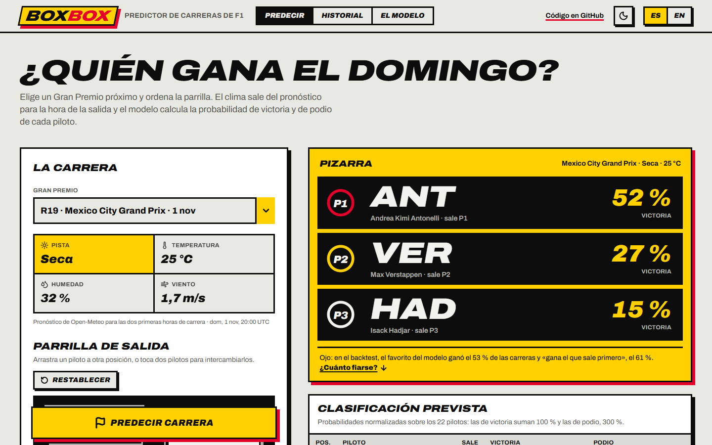
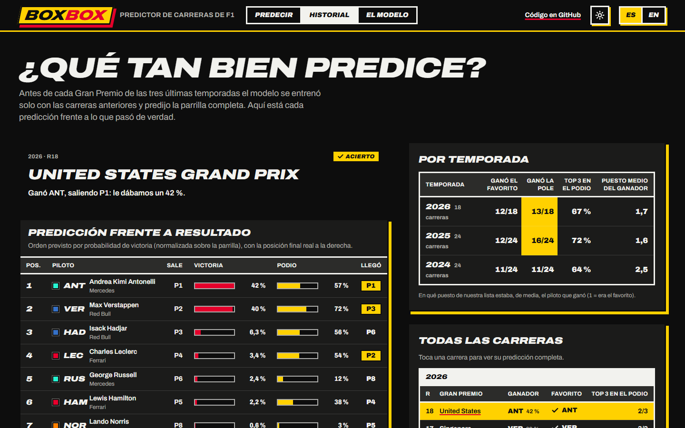
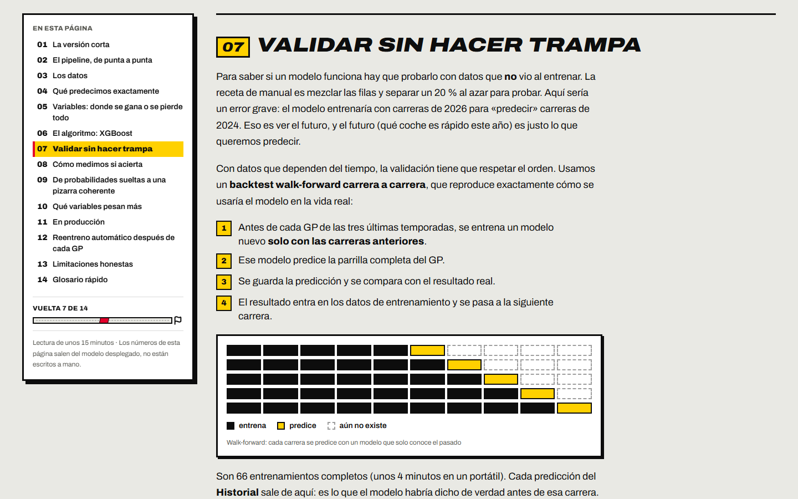
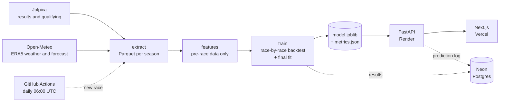

# BoxBox

**Who wins on Sunday?** An end-to-end Formula 1 race predictor: real data since 2022, an XGBoost model
validated race by race and retrained automatically after every Grand Prix, a FastAPI backend and a
Next.js dashboard in Spanish and English.

**[Try the site](https://boxbox-azure.vercel.app/en)** ·
[How the model works](https://boxbox-azure.vercel.app/en/how) ·
[Prediction track record](https://boxbox-azure.vercel.app/en/review) ·
[API (OpenAPI)](https://boxbox-api-4nx4.onrender.com/docs)



> An independent portfolio and learning project, not affiliated with Formula 1.
> The API runs on Render's free plan: after a while without visits, the first load takes about a minute.

## What it does

- **Predicts the next GP.** Pick a race from the calendar and set the grid (drag a driver, or tap two to
  swap them). The model gives every one of the 22 drivers a win chance and a podium chance.
- **Nobody types the weather.** It comes from the Open-Meteo forecast for the first two hours of the race,
  as soon as the race is 14 days away or less.
- **Shows its work.** The *Track record* lists every GP of the last three seasons with what the model predicted
  before the race (without knowing the result) next to what actually happened.
- **Explains itself.** The *Model* tab is a ~15-minute guide for software engineers who know machine learning
  in theory: features, XGBoost, validation, metrics and MLOps, quoting the deployed model's own numbers.
- **Learns on its own.** A GitHub Actions workflow spots each new race, retrains, validates and deploys.

| Track record: prediction vs result | Model guide |
| --- | --- |
|  |  |

The screenshots show the Spanish interface; every page is also available in English under `/en`.

## How it works



1. **Data.** One row per driver per race (2022 onwards, the ground-effect era): grid slot, qualifying,
   gap to pole, circuit, weather and result. Currently 2,234 rows from 110 races.
2. **Features.** 18 columns built only from information available before lights out: grid slot, recent form
   of driver and team (with `shift(1)` so the future never leaks in), how hard the circuit is to pass on,
   wet-weather record, weather. Training and inference share the same `build_features` function.
3. **Model.** Multiclass XGBoost (win · P2–P3 · rest) with shallow, regularised trees.
   P(podium) = P(win) + P(P2–P3), so it can never be lower than the win chance.
4. **Validation.** Race-by-race walk-forward over the last three seasons (66 GPs): before each race the model
   is trained only on earlier ones. It is compared with a baseline that only looks at the grid.
5. **Serving.** The API loads the model once, fetches the calendar and the forecast (cached for an hour),
   normalises the probabilities across the whole grid and logs every prediction to Postgres.

The full explanation, written for people who haven't done ML in practice, is in
[the guide on the site](https://boxbox-azure.vercel.app/en/how).

### Backtest results

66 races (2024–2026), each predicted without having seen it:

| Metric | Model | Grid only |
| --- | ---: | ---: |
| Log loss (lower is better) | **0.292** | 0.311 |
| Win AUC | **0.959** | 0.942 |
| Favourite wins | 53 % | **61 %** |
| Top 3 on the podium | 68 % | **69 %** |

The model orders the whole field better and its probabilities are better calibrated. But when it has to name
a single winner it is right less often than "the pole sitter wins". That's why the site shows probabilities,
not a winner. The current figures always live in [`boxbox-ml/artifacts/metrics.json`](boxbox-ml/artifacts/metrics.json) and in `GET /health`.

## Stack

| Part | Technology |
| --- | --- |
| Data and model (`boxbox-ml/`) | Python 3.13, uv, pandas, XGBoost, scikit-learn, FastF1 (Jolpica client), Open-Meteo |
| API (`backend/`) | FastAPI, SQLModel, psycopg 3, PostgreSQL on Neon, Docker |
| Web (`frontend/`) | Next.js 16 (App Router, Cache Components), React 19, TypeScript, Tailwind CSS 4, anime.js 4, pnpm |
| Operations | GitHub Actions (retraining), Render (API), Vercel (web) |

## Repository layout

```text
boxbox/
├── boxbox-ml/                 # data and model library (Python package `boxbox_ml`)
│   ├── src/boxbox_ml/
│   │   ├── sources/           # Jolpica and Open-Meteo clients
│   │   ├── extract.py         # download → data/race_entries.parquet
│   │   ├── features.py        # feature engineering (shared with the API)
│   │   ├── train.py           # walk-forward backtest + final model
│   │   ├── predictor.py       # model loading and prediction (no data dependencies)
│   │   └── load_db.py         # upserts results into Neon
│   └── artifacts/             # model.joblib and metrics.json (versioned)
├── backend/                   # FastAPI app
│   ├── app/                   # routes, schemas, services (prediction, calendar)
│   ├── scripts/init_db.py     # creates the tables
│   └── Dockerfile             # built from the repository root
├── frontend/                  # Next.js dashboard
│   └── src/
│       ├── app/[lang]/        # pages: predict, track record (review), guide (how)
│       ├── components/        # Atomic Design: atoms, molecules, organisms, templates + motion
│       ├── dictionaries/      # es / en copy
│       └── lib/               # API client, grid logic, animation presets
├── .github/workflows/retrain.yml
└── docs/screenshots/
```

## Running it locally

Requirements: [uv](https://docs.astral.sh/uv/) (it installs Python 3.13 for you), Node 24 (the tests use its
native TypeScript support) and [pnpm](https://pnpm.io/) 11. The database is optional for trying it out: the API
works without one and simply stops logging predictions.

### 1. Model

The repository already ships a trained model (`boxbox-ml/artifacts/model.joblib`), so this step is only needed
to retrain:

```bash
cd boxbox-ml
uv sync
uv run python -m boxbox_ml.extract   # downloads results and weather (a few minutes the first time)
uv run python -m boxbox_ml.train     # 66-race backtest + final model (~4 min)
uv run pytest
```

### 2. API

```bash
cd backend
uv sync
cp .env.example .env                 # put your Postgres URL, or keep the placeholder if you don't need it
uv run uvicorn app.main:app --reload # http://localhost:8000/docs
uv run pytest
```

With a Neon database (or any Postgres), create the tables and load the results:

```bash
uv run python -m scripts.init_db                      # in backend/
cd ../boxbox-ml && uv run python -m boxbox_ml.load_db
```

| Variable (`backend/.env`) | Purpose |
| --- | --- |
| `DATABASE_URL` | *Pooled* connection (host with `-pooler` on Neon). Used by the API. |
| `DATABASE_URL_UNPOOLED` | Direct connection, for creating tables. Optional; falls back to the one above. |
| `DB_ECHO` | `true` to log SQL. |
| `MODEL_PATH` | Model location. Defaults to `../boxbox-ml/artifacts/model.joblib`. |

### 3. Web

```bash
cd frontend
pnpm install
cp .env.example .env.local           # BOXBOX_API_URL=http://localhost:8000
pnpm dev                             # http://localhost:3000 → redirects to /es or /en based on the browser
```

`BOXBOX_API_URL` is only used by the Next.js server: the browser never calls the API directly, so no CORS
is needed.

### Docker (API)

```bash
docker build -f backend/Dockerfile -t boxbox-api .   # from the root: the API depends on boxbox-ml/
docker run --env-file backend/.env -p 8000:8000 boxbox-api
```

## API

| Method | Path | Returns |
| --- | --- | --- |
| GET | `/health` | Model version, backtest metrics and training details (rows, trees, feature importance) |
| GET | `/races/upcoming` | Upcoming GPs with the race-start forecast; `weather` is `null` until the race is within the 14-day forecast range |
| GET | `/drivers` | Current grid, with each driver's starting slot at the last race |
| GET | `/circuits` | Circuits the model knows |
| GET | `/review` | Race-by-race backtest: the model's favourite vs the actual winner |
| GET | `/review/{season}/{round}` | One backtest race with the full predicted field and the real finishing positions |
| POST | `/predict` | Win and podium probability per driver |

```http
POST /predict
Content-Type: application/json

{
  "circuit_ref": "rodriguez",
  "season": 2026,
  "round": 19,
  "weather": { "air_temp_c": 25, "humidity_pct": 32, "wind_speed_ms": 1.7, "rainfall": false },
  "entries": [
    { "driver_ref": "antonelli", "grid_position": 1 },
    { "driver_ref": "max_verstappen", "grid_position": 2, "quali_gap_pct": 0.08 }
  ],
  "normalize": false
}
```

With the full grid, `normalize: true` rescales so win chances add up to 100 % and podium chances to 300 %.
Interactive docs are at `/docs`.

## Automatic retraining

[`.github/workflows/retrain.yml`](.github/workflows/retrain.yml) runs every day at 06:00 UTC (Jolpica publishes
results a few hours after the race) and can also be started by hand from the *Actions* tab:

1. downloads new results and weather (finished seasons stay cached);
2. if there is a race newer than the last one the model knows (`data_to` in `metrics.json`), it retrains;
3. **quality gate**: the new model must beat the grid-only baseline on log loss and AUC;
4. runs the API tests against the new model;
5. loads the results into Neon, if the repository has a `DATABASE_URL` secret;
6. commits `model.joblib` and `metrics.json`. That push redeploys Render and Vercel.

If any step fails, the deployed model stays as it is and GitHub sends an email. Because the model lives in git,
rolling back is a `git revert`.

## Deployment

Both services deploy on their own with every push to `main`.

| Service | Where | Configuration |
| --- | --- | --- |
| API | Render, Docker, Virginia region (next to Neon) | `backend/Dockerfile` with the repository root as context. Variable `DATABASE_URL`. |
| Web | Vercel, root `frontend/`, Node 24 | Variable `BOXBOX_API_URL` with the API URL. Install `npx -y pnpm@11.24.0 install --frozen-lockfile` and build `npx -y pnpm@11.24.0 run build` (Vercel only reads `packageManager` at the repository root). |
| Retraining | GitHub Actions | Optional `DATABASE_URL` secret to load results into Neon. |

## Quality

```bash
cd boxbox-ml && uv run pytest        # data sources and features
cd backend   && uv run pytest        # API against the real model
cd frontend  && pnpm test            # grid, language and track-record logic (node --test)
cd frontend  && pnpm lint && pnpm format:check && pnpm build
```

Repository conventions: exact dependency versions (uv.lock and pnpm-lock.yaml), uv for Python and pnpm for Node,
Atomic Design components, and all copy in the `es` / `en` dictionaries. Animations (anime.js) are declared
through `data-anim` attributes and switch off when the system asks for reduced motion.

## Limitations

- **Little data.** About 2,000 rows and around a hundred winners: every rare win weighs a lot.
- **No telemetry.** FastF1 needs an F1 TV subscription for laps and telemetry, so the model can't see race pace,
  strategy, tyres or safety cars.
- **The grid is a guess** until qualifying is run: by default it uses the last race's starting order.
- **No drift monitoring** yet: predictions are logged, but nothing alerts when the model gets worse.

## Data and credits

- Results and calendar: [Jolpica F1 API](https://github.com/jolpica/jolpica-f1), the Ergast successor, through
  the [FastF1](https://github.com/theOehrly/Fast-F1) client.
- Weather: [Open-Meteo](https://open-meteo.com/) (ERA5 reanalysis for history, forecast for upcoming races).

Formula 1, F1 and the team and driver names are trademarks of their respective owners. This project is not
affiliated with them.
