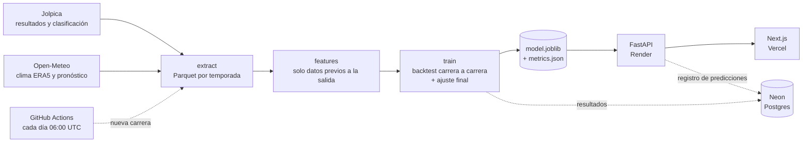

# BoxBox

**¿Quién gana el domingo?** Un predictor de carreras de Fórmula 1 de punta a punta: datos reales desde
2022, un modelo XGBoost que se valida carrera a carrera y se reentrena solo después de cada Gran Premio,
una API en FastAPI y un dashboard en Next.js en español e inglés.

**[Probar la web](https://boxbox-azure.vercel.app)** ·
[Cómo funciona el modelo](https://boxbox-azure.vercel.app/es/how) ·
[Historial de predicciones](https://boxbox-azure.vercel.app/es/review) ·
[API (OpenAPI)](https://boxbox-api-4nx4.onrender.com/docs)


> Proyecto independiente con fines de portafolio y aprendizaje. Sin afiliación con la Fórmula 1.
> La API corre en el plan gratuito de Render: si lleva un rato sin visitas, la primera carga tarda cerca de un minuto.

## Qué hace

- **Predice el próximo GP.** Eliges una carrera del calendario y ordenas la parrilla (arrastrando o tocando dos
  pilotos). El modelo da la probabilidad de victoria y de podio de los 22 pilotos.
- **El clima no se escribe a mano.** Sale del pronóstico de Open-Meteo para las dos primeras horas de carrera,
  en cuanto la carrera está a 14 días o menos.
- **Rinde cuentas.** El *Historial* enseña, para cada GP de las tres últimas temporadas, lo que el modelo predijo
  antes de la carrera (sin conocer el resultado) junto a lo que pasó de verdad.
- **Se explica.** La pestaña *El modelo* es una guía de unos 15 minutos para ingenieros de software que conocen
  el machine learning en teoría: variables, XGBoost, validación, métricas y MLOps, con los números del modelo desplegado.
- **Aprende solo.** Un workflow de GitHub Actions detecta cada carrera nueva, reentrena, valida y despliega.

| Historial: predicción frente a resultado | Guía del modelo |
| --- | --- |
|  |  |

## Cómo funciona



1. **Datos.** Una fila por piloto y carrera (2022 en adelante, la era de efecto suelo): parrilla, clasificación,
   distancia a la pole, circuito, clima y resultado. Hoy son 2.234 filas de 110 carreras.
2. **Variables.** 18 columnas que solo usan información anterior a la salida: posición de salida, forma reciente
   del piloto y del equipo (con `shift(1)` para no filtrar el futuro), dificultad para adelantar en el circuito,
   historial en mojado, clima. Entrenamiento e inferencia usan la misma función `build_features`.
3. **Modelo.** XGBoost multiclase (victoria · P2–P3 · resto), árboles poco profundos y regularizados.
   P(podio) = P(victoria) + P(P2–P3), así que nunca es menor que la de ganar.
4. **Validación.** Walk-forward carrera a carrera en las tres últimas temporadas (66 GP): antes de cada carrera se
   entrena solo con las anteriores. Se compara con una línea base que solo mira la parrilla.
5. **Servicio.** La API carga el modelo una vez, consulta el calendario y el pronóstico (con caché de 1 h),
   normaliza las probabilidades de toda la parrilla y registra cada predicción en Postgres.

La explicación completa, pensada para quien no ha hecho ML en la práctica, está en
[la guía de la web](https://boxbox-azure.vercel.app/es/how).

### Resultados del backtest

66 carreras (2024–2026), cada una predicha sin haberla visto:

| Métrica | Modelo | Solo parrilla |
| --- | ---: | ---: |
| Log loss (menos es mejor) | **0,292** | 0,311 |
| AUC de victoria | **0,959** | 0,942 |
| El favorito gana | 53 % | **61 %** |
| Top 3 en el podio | 68 % | **69 %** |

El modelo ordena mejor a todo el pelotón y sus probabilidades están mejor calibradas. Pero al nombrar un único
ganador acierta menos que «gana el que sale primero». Por eso la web muestra probabilidades y no un ganador.
Las cifras actuales están siempre en [`boxbox-ml/artifacts/metrics.json`](boxbox-ml/artifacts/metrics.json) y en `GET /health`.

## Stack

| Parte | Tecnología |
| --- | --- |
| Datos y modelo (`boxbox-ml/`) | Python 3.13, uv, pandas, XGBoost, scikit-learn, FastF1 (cliente de Jolpica), Open-Meteo |
| API (`backend/`) | FastAPI, SQLModel, psycopg 3, PostgreSQL en Neon, Docker |
| Web (`frontend/`) | Next.js 16 (App Router, Cache Components), React 19, TypeScript, Tailwind CSS 4, anime.js 4, pnpm |
| Operación | GitHub Actions (reentreno), Render (API), Vercel (web) |

## Estructura del repositorio

```text
boxbox/
├── boxbox-ml/                 # librería de datos y modelo (paquete Python `boxbox_ml`)
│   ├── src/boxbox_ml/
│   │   ├── sources/           # clientes de Jolpica y Open-Meteo
│   │   ├── extract.py         # descarga → data/race_entries.parquet
│   │   ├── features.py        # ingeniería de variables (compartida con la API)
│   │   ├── train.py           # backtest walk-forward + modelo final
│   │   ├── predictor.py       # carga del modelo y predicción (sin dependencias de datos)
│   │   └── load_db.py         # upsert de resultados en Neon
│   └── artifacts/             # model.joblib y metrics.json (versionados)
├── backend/                   # API FastAPI
│   ├── app/                   # rutas, esquemas, servicios (predicción, calendario)
│   ├── scripts/init_db.py     # crea las tablas
│   └── Dockerfile             # se construye desde la raíz del repo
├── frontend/                  # dashboard Next.js
│   └── src/
│       ├── app/[lang]/        # páginas: predecir, historial (review), guía (how)
│       ├── components/        # Atomic Design: atoms, molecules, organisms, templates + motion
│       ├── dictionaries/      # textos en es / en
│       └── lib/               # cliente de la API, lógica de parrilla, presets de animación
├── .github/workflows/retrain.yml
└── docs/screenshots/
```

## Ejecutarlo en local

Requisitos: [uv](https://docs.astral.sh/uv/) (instala Python 3.13 solo), Node 24 (los tests usan su soporte nativo de TypeScript) y
[pnpm](https://pnpm.io/) 11. La base de datos es opcional para probarlo: la API funciona sin ella y solo deja de
registrar las predicciones.

### 1. Modelo

El repositorio ya trae un modelo entrenado (`boxbox-ml/artifacts/model.joblib`), así que este paso solo hace
falta para reentrenar:

```bash
cd boxbox-ml
uv sync
uv run python -m boxbox_ml.extract   # descarga resultados y clima (la primera vez tarda unos minutos)
uv run python -m boxbox_ml.train     # backtest de 66 carreras + modelo final (~4 min)
uv run pytest
```

### 2. API

```bash
cd backend
uv sync
cp .env.example .env                 # pon la URL de tu Postgres, o deja la de ejemplo si no la necesitas
uv run uvicorn app.main:app --reload # http://localhost:8000/docs
uv run pytest
```

Con una base de datos de Neon (o cualquier Postgres), crea las tablas y carga los resultados:

```bash
uv run python -m scripts.init_db                      # en backend/
cd ../boxbox-ml && uv run python -m boxbox_ml.load_db
```

| Variable (`backend/.env`) | Uso |
| --- | --- |
| `DATABASE_URL` | Conexión *pooled* (host con `-pooler` en Neon). La usa la API. |
| `DATABASE_URL_UNPOOLED` | Conexión directa, para crear tablas. Opcional; si falta se usa la anterior. |
| `DB_ECHO` | `true` para ver el SQL en el log. |
| `MODEL_PATH` | Ruta del modelo. Por defecto `../boxbox-ml/artifacts/model.joblib`. |

### 3. Web

```bash
cd frontend
pnpm install
cp .env.example .env.local           # BOXBOX_API_URL=http://localhost:8000
pnpm dev                             # http://localhost:3000 → redirige a /es o /en según el navegador
```

`BOXBOX_API_URL` solo se usa en el servidor de Next.js: el navegador nunca llama a la API directamente, así que
no hace falta CORS.

### Docker (API)

```bash
docker build -f backend/Dockerfile -t boxbox-api .   # desde la raíz: la API depende de boxbox-ml/
docker run --env-file backend/.env -p 8000:8000 boxbox-api
```

## API

| Método | Ruta | Qué devuelve |
| --- | --- | --- |
| GET | `/health` | Versión del modelo, métricas del backtest y datos del entrenamiento (filas, árboles, importancia de cada variable) |
| GET | `/races/upcoming` | Próximos GP con el pronóstico de la salida; `weather` es `null` hasta que la carrera entra en los 14 días del pronóstico |
| GET | `/drivers` | Parrilla actual, con la posición de salida de la última carrera |
| GET | `/circuits` | Circuitos que conoce el modelo |
| GET | `/review` | Backtest carrera a carrera: favorito del modelo frente al ganador real |
| GET | `/review/{season}/{round}` | Una carrera del backtest con la parrilla prevista completa y la posición final real |
| POST | `/predict` | Probabilidad de victoria y podio por piloto |

```http
POST /predict
Content-Type: application/json

{
  "circuit_ref": "rodriguez",
  "season": 2026,
  "round": 19,
  "weather": { "air_temp_c": 25, "humidity_pct": 32, "wind_speed_ms": 1.7, "rainfall": false },
  "entries": [
    { "driver_ref": "antonelli", "grid_position": 1 },
    { "driver_ref": "max_verstappen", "grid_position": 2, "quali_gap_pct": 0.08 }
  ],
  "normalize": false
}
```

Con la parrilla completa, `normalize: true` reescala para que las victorias sumen 100 % y los podios 300 %.
La documentación interactiva está en `/docs`.

## Reentreno automático

[`.github/workflows/retrain.yml`](.github/workflows/retrain.yml) se ejecuta todos los días a las 06:00 UTC
(Jolpica publica los resultados unas horas después de la carrera) y también a mano desde la pestaña *Actions*:

1. descarga los resultados y el clima nuevos (las temporadas cerradas quedan en caché);
2. si hay una carrera más reciente que la última que conoce el modelo (`data_to` en `metrics.json`), reentrena;
3. **puerta de calidad**: el modelo nuevo tiene que ganar a la línea base «solo parrilla» en log loss y AUC;
4. pasa los tests de la API con el modelo nuevo;
5. carga los resultados en Neon, si el repositorio tiene el secreto `DATABASE_URL`;
6. hace commit de `model.joblib` y `metrics.json`. Ese push redespliega Render y Vercel.

Si algo falla, el modelo desplegado no cambia y GitHub avisa por correo. Como el modelo vive en git, volver a la
versión anterior es un `git revert`.

## Despliegue

Los dos servicios se despliegan solos con cada push a `main`.

| Servicio | Dónde | Configuración |
| --- | --- | --- |
| API | Render, Docker, región Virginia (junto a Neon) | `backend/Dockerfile` con contexto en la raíz del repo. Variable `DATABASE_URL`. |
| Web | Vercel, raíz `frontend/`, Node 24 | Variable `BOXBOX_API_URL` con la URL de la API. Instalación `npx -y pnpm@11.24.0 install --frozen-lockfile` y build `npx -y pnpm@11.24.0 run build` (Vercel solo lee `packageManager` en la raíz del repo). |
| Reentreno | GitHub Actions | Secreto opcional `DATABASE_URL` para cargar los resultados en Neon. |

## Calidad

```bash
cd boxbox-ml && uv run pytest        # fuentes de datos y variables
cd backend   && uv run pytest        # API contra el modelo real
cd frontend  && pnpm test            # lógica de parrilla, idioma e historial (node --test)
cd frontend  && pnpm lint && pnpm format:check && pnpm build
```

Convenciones del repo: dependencias con versión exacta (uv.lock y pnpm-lock.yaml), uv para Python y pnpm para
Node, componentes en Atomic Design, textos siempre en los diccionarios `es` / `en`. Las animaciones (anime.js)
se declaran con atributos `data-anim` y se desactivan si el sistema pide reducir el movimiento.

## Limitaciones

- **Pocos datos.** Unas 2.000 filas y un centenar de ganadores: cada victoria rara pesa mucho.
- **Sin telemetría.** FastF1 exige una suscripción a F1 TV para vueltas y telemetría, así que el modelo no ve el
  ritmo de carrera, la estrategia, los neumáticos ni los safety cars.
- **La parrilla es una suposición** hasta que se disputa la clasificación: por defecto se usa el orden de la última carrera.
- **Sin vigilancia de deriva** todavía: las predicciones se registran, pero aún no hay alertas cuando el modelo empeora.

## Datos y créditos

- Resultados y calendario: [Jolpica F1 API](https://github.com/jolpica/jolpica-f1), el sucesor de Ergast, a través
  del cliente de [FastF1](https://github.com/theOehrly/Fast-F1).
- Clima: [Open-Meteo](https://open-meteo.com/) (reanálisis ERA5 para el histórico y pronóstico para las próximas carreras).

Fórmula 1, F1 y los nombres de equipos y pilotos son marcas de sus respectivos dueños. Este proyecto no está
afiliado a ellos.
